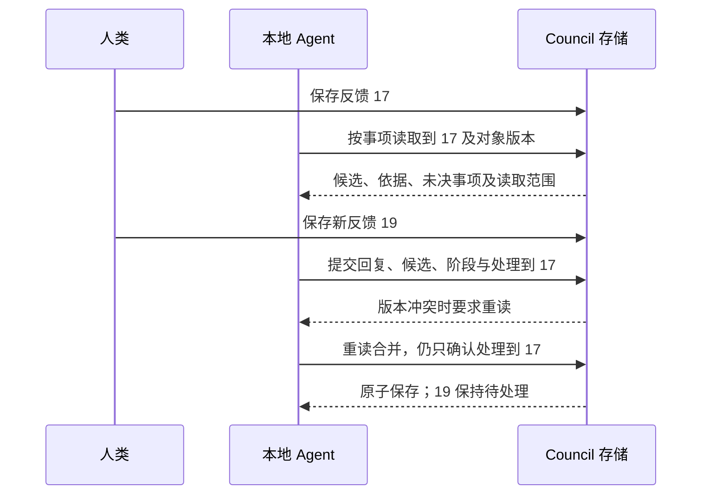

# OppenCouncil v5 实施设计与迁移映射

_2026-10-14 · OPP-21 实施稿 · 五项取舍按 Linear 更新，进入实现_

---

## 📋 范围与依据

本稿将已经定稿的产品需求映射到当前源码，并提出实施所需的字段、接口和迁移方案。五项取舍以本轮人类指示及最新 Linear 已决定为准，其余技术字段作为实施设计；不把 Linear 的长篇需求直接写入运行时 Skill。OPP-21 明确要求本稿中的迁移映射及子 issue 待细化事项先经人类确认。[^1]

| 需求来源 | 已定范围 | 本稿需细化 |
| --- | --- | --- |
| OPP-21[^1] | 概念模型、存储保证、实施边界 | 迁移映射、分步验收 |
| OPP-19[^2] | 分诊、证据、增量接续、权限收窄 | 数据模型、事务、确认依据 |
| OPP-20[^3] | 单一 skill、项目类型、迁移与改名 | 标记、目录、命令、Memory 文本 |
| OPP-22[^4] | Results、Releases、Explore、Data | 遗留产出过渡、登记与资产生命周期 |
| OPP-23[^5] | 保留页面、增加表格和图片 | 表格结构、图片版本、反馈事件 |

读取时五个 issue 均处于 Backlog，正文标注设计定稿；四个子 issue 的 parent 均为 OPP-21，没有额外评论。项目概述仍是早期规划文字，本稿采用五个指定 issue 的当前正文作为需求依据。

开发基线为 `a871bea87add686eece05ac6ac28c6e58c7ea869`（4.3.1）。独立 worktree 为 `<development-worktree>`，分支 `codex/opp-21-v5-design`。已安装源 `<installed-checkout>` 保持原分支及源码；全局 skill 链接仍指向该安装源。

worktree 使用已安装 v4 Steward 管理，重新登记七个现有产品源码 owner；没有复制真实项目的 Freeze、Memory、Audit、运行配置或凭据。开发期间不改版本号；发布时才按 OPP-21 统一升至 5.0.0。

## 🔍 当前实现与关键差距

以下均由本次源码读取确认。

| 当前实现 | v5 影响 |
| --- | --- |
| [store.py](../council/oppencouncil/store.py:133) 只识别两种 skill 的 v3/v4 标记 | 新增统一 v5 识别，布局与类型分离 |
| manifest schema 为 1/2，F schema 为 1；messages 只追加，没有处理游标 | 需要显式迁移和接续索引 |
| [definitions.py](../council/oppencouncil/definitions.py:16) 的确认 token 绑定正文和依赖 | 需绑定决定性依据和送审材料 |
| 同文件拒绝正文、依赖均未变化的新确认 | 需允许依据发生实质变化后的重新确认 |
| [decisions.py](../council/oppencouncil/decisions.py:47) journal 仅接受 manifest、groups、questions | 扩展到调查和证据；复用锁、写入、恢复机制 |
| journal 提交点之后崩溃会向前恢复 | 项目迁移的失败回滚不能直接等同于这个提交机制 |
| 单 JSON 上限 1 MiB、单事务上限 16 MiB | 证据独立存储；大项目迁移需独立恢复设计 |
| [freeze.py](../mcp/oppenproject/freeze.py:44) 允许 MCP 调用方填写 codex/chatgpt actor | v5 必须由入口确定身份，不能通过自报 actor 绕过外部权限 |
| 现有 Results producer 必须是 R 目录内 R 脚本 | 改为科研类型的编号脚本，不依赖语言 |
| [governance-baseline.json](../tests/integration/governance-baseline.json) 锁定两个 Memory 段落及 helper 整体 AST | 先确认 Memory 语义，再缩小哈希边界，补行为测试 |

### 需要讨论的实际缺口

1. 旧数据没有可靠的处理回执。单靠“最后一条是 AI 回复”不能判定更早的意见都已解决。
2. 证据改变而正文不变时，需决定生成新的正式版本，还是追加独立的重新审阅凭据。
3. 遗留 Results 缺少产出口径不阻塞迁移，但新规则要求正式产出必须有关联口径。需要明确旧产出的过渡范围。
4. 图片放在可继续修改或归档的 Explore 中，而正式及历史版本要显示当时的图片。仅保存普通路径不能保证历史一致。
5. OPP-20 要求失败回滚；旧 Freeze journal 的保证是提交后向前恢复。两者需要不同事务边界。

这些缺口已经由人类在 Linear 中确定，以下采用最新规则，不沿用首稿的替代提案。

## 💾 建议的数据模型

### 唯一注册表与版本标记

在项目现有唯一注册表中记录 `<!-- oppencouncil:v5 -->`，并增加一个由 helper 管理的 JSON 元数据块：`governance_version: 5`、`project_type: research|general`。原位置保持 `project.md` 或 `.oppen-project-steward/registry.md`；布局由位置识别，不再用 skill 名字推断类型。

新项目显式选择类型；旧 Stepwise 默认 research、Steward 默认 general，check 报告展示推断及允许的显式覆盖。新记录采用 manifest schema 3、F schema 2；软件版本号、治理版本号、存储 schema 和正式口径版本是四个独立概念。

### 存储位置及责任

| 位置（拟定） | 唯一负责的内容 |
| --- | --- |
| `Freeze/questions/F-NNNNNN.json` | definition、F 的本次修订、反馈与处理进度、验证测试关联 |
| `Freeze/investigations/I-NNNNNN.json` | 尚无 F 的调查、分诊出口、排除或关闭理由、关联 F |
| `Freeze/evidence/sources/S-NNNNNN/rNNNNNN.json` | 不可覆盖的来源版本及定位、核查记录 |
| `Freeze/evidence/claims/E-NNNNNN/rNNNNNN.json` | 不可覆盖的判断版本及来源引用、适用条件、反证 |
| `Freeze/evidence/submissions/X-<uuid>.json` | 外部提交、质疑、回应和新问题建议，只追加 |
| `Freeze/decision-groups.json` | 现有主题/分组、共享讨论、组级反馈进度 |
| 原项目注册表 | 类型、目录角色、产出登记、迁移例外及索引入口 |

每个证据版本一个文件，继续执行大小上限；长报告保留在 MCP Discussion，证据条目引用 D 编号及内容哈希。证据索引及反向关联可重建，不成为第二份事实来源。

调查可关联零个、一个或多个 F；每个工作阶段只有一个负责对象。形成 F 后，调查记录关闭为 `formed_definition`，后续修订由 F 负责；不让调查和 F 同时维护同一任务阶段。并列但独立的 F 分别推进。

外部新问题保存在证据提交中，由本地 Agent 接收并分诊后才形成调查事项，避免外部 AI 直接向人类队列灌入问题。调查与 F 不共用编号，既有 F 和 B 编号保持不变。

### 字段与枚举

| 对象 | 建议字段 |
| --- | --- |
| 本次修订 `work` | `revision_id`、`phase`、`conclusion_type`、`trigger_refs`、`affected_refs`、`completion_conditions`、`blockers`、`closed_reason` |
| 工作阶段 | `triage`、`evidence`、`prepare_review`、`human_review`、`closed` |
| 分诊出口 | `not_applicable`、`fact_lookup`、`covered`、`single_recommendation`、`parallel_recommendations`、`departure`、`tradeoff`、`needs_check` |
| 阶段转换记录 | 前后阶段、触发输入、失效条件、影响范围、完成条件、actor、时间 |
| 来源 | 类型、URL/DOI/本地引用、原文定位、读取范围、取得时间、核查贡献者、披露范围 |
| 核查方式 | `full_text_location`、`abstract_only`、`model_claim_only`；项目事实另用 `code_check`、`data_check`、`measurement` |
| 判断 | 明确判断、支持/反对的来源版本、适用条件、使用广度描述、相关 F、未决异议 |
| 送审材料 | 推荐及其依据、默认值与项目理由、偏离检查、未决分歧、候选引用、决定性判断版本 |
| 验证测试 | 相对路径、验证范围、关联正式版本；原注册表信息无损迁入 |

来源类型沿用 issue 所列方法学指南、报告规范、可比研究、方法学文献、项目经验；使用广度用描述和出处表达，不生成跨来源等级。仅模型声称的材料可作为线索，但不能满足推荐依据检查。外部自报“已读全文”作为贡献记录保留，是否足以用于本项目推荐由本地核查记录说明。

项目事实、工程约束和科研方法学按问题类型区分证据要求；程序检查必填结构与版本绑定，Agent 判断证据充分性和实际差异。

### 调查去重与未决事项

调查保存 `dedupe_key`、问题范围、已有 F/调查引用以及原触发证据。相同键只用于提示复用，语义是否相同由本地 Agent 判断；不以标题相似度自动删除事项。排除原因与依据保存在原调查中，网页的“已排除”只是查询视图。

未决事项保存在负责对象的 `pending_items`，包含稳定 ID、输入引用、尚未解决的问题、阻塞原因、继续条件、条件核查记录与解决记录。继续条件分为可由程序判断的依赖版本/新材料到达，以及需本地 Agent 判断的事实条件。每次接续检查条件；外部提交到达只触发核查，不自动证明其内容成立。

恢复排除项在原调查上增加一次新的调查修订，保存恢复要求作为触发证据，保留旧排除历史。网页没有新分区，按现有筛选展示。

## 🔄 反馈、事务与证据确认

### 反馈和增量读取

保留旧 messages 原有 ID、作者、文本和顺序；新增 `feedback_events`，统一引用人类留言、已保存候选修改、已保存选项选择及组讨论。事件具有稳定 ID 和同一负责对象内的单调序号。未保存的浏览器偏好不算反馈。

`processing` 保存已处理的人类事件游标、外部输入游标、依赖/证据变更引用和迁移接续状态。外部输入会进入本地工作索引，但不计入“待 AI 处理”的人类反馈计数。F 与 B 共享讨论只保留一个处理 owner；事件可引用受影响成员，防止重复消费。

本地提交必须携带读取时的对象 revision、处理到的具体事件 ID、对应回复或未决事项、候选与阶段修改。程序拒绝越过未登记处理结果的已知人类事件；新到事件不进入本次处理范围。

复用项目锁和请求指纹；同一请求号、同一内容重试返回已保存结果，变化的写集使用新请求号。只在持锁校验全部读版本后提交。journal 白名单扩展到明确 schema 的调查和证据路径，不能接受任意相对文件写入。

“复制交接说明”根据工作索引生成，只包含新输入及继续条件已满足的未决事项；snapshot 仍可用于审计/恢复，不作为默认接续接口。

### 决定性依据与人类确认

建议将送审依据固定为一个不可变的 `review_basis`：判断版本、来源版本、适用性说明、决定性引用及送审材料摘要哈希。候选确认 token 同时绑定正文、依赖及该依据版本。

来源更新后，程序沿来源→判断→F 给出影响候选；本地 Agent 逐项记录是无实质变化、需补查还是实质削弱，以及理由。外部质疑自身不直接废止正式口径。实质削弱时，仅受影响候选失去旧确认资格并显示重审原因；原正式版本仍有效，直至人类确认修订。

**已决定：正文不变时，在当前正式版本上追加重新确认记录**，记录确认人、时间及证据版本，不增加正式版本号。正文哈希与依赖绑定保持不变，避免下游无故进入需要复核。正文修改才走正常候选和新版本确认。

书目信息补全和格式调整只增加来源记录，不自动改变已送审依据；无需因此强迫重审。不能通过改一个时间戳制造新的依据确认。

旧正式版本的正文、原确认、依赖及哈希保持不变；重新确认仅追加记录，不改写已有记录。历史哈希按原算法验证；新版本显式携带确认结构版本。迁移统一当前记录结构，不追溯改写历史确认含义。不能把旧版本补写成“已通过 v5 证据审查”。

多 AI 异议保留各自出处和版本；本地整理逐条记录解决理由或保留为已充分说明的真实取舍。结构检查保证每项决定性缺口有处理结果，但不以多数意见或机械清空异议作为送审条件。

## 📦 旧字段映射与迁移

### 确定性字段映射

| v4 内容 | 建议 v5 处理 |
| --- | --- |
| `definition.versions/current_version/draft` | 原值保留；当前 F 外层补充工作、证据和验证字段 |
| `status=frozen` | 正式状态由 definition 推导；不凭 status 创建正式版本 |
| `status=discussing/open/answered` | 不映射为一个新总状态；按候选、反馈及可核实进度初始化 |
| `status=historical` | 保留只读历史恢复标记，按是否存在真实 definition 展示 |
| `user_answer` | 转为带来源的“历史答复 · 非正式口径”讨论记录，不伪造原时间 |
| `ai_position` 及来源字段 | 对照已有 messages，存在对应记录则引用；否则追加历史导入记录 |
| `messages`、组 `messages/history/confirmations` | 保持原记录；新反馈索引按引用指向，不改旧 ID |
| `review_notes/discussion_display` | 保留出处和显示关系；待整理成证据，不自动宣称已核查 |
| `round` | 保留批次号；不作为工作阶段或处理进度 |
| 依赖和 `dependency_reviews` | 保留具体版本、哈希和兼容记录；readiness 继续派生 |
| `requests/request_actors` | 保留旧请求回执；新请求使用带操作命名空间的回执 |
| Attention | 转为调查事项，保留原编号引用、状态及全文来源；已解决记录不重开 |
| Markdown Canonical | 登记继续有效并列入分类报告；研究含义逐条进入 Council，技术约定转代码/测试 |
| 既有 F 的 canonical 验证路径 | 移入对应 F 的测试属性；未知归属列报告，不猜测 |
| Memory | 原文、ID、状态、关系、索引和历史全部保留 |
| 模块/函数审计、旧 HTML 示例 | 只读历史保留；不进入新流程和页面 |
| Results 登记 | 保留原 ID、路径、类型、受众、producer，增加待关联标记，不伪造 F |
| R、Releases、Explore、Data | 识别原布局；分类不明、缺清单或缺状态只列报告 |

旧字段的导入使用确定性来源键，避免重复执行追加相同历史答复。当前记录不再暴露旧字段作为可编辑的第二份内容，原值通过迁移来源记录保留；消息重复只有在明确来源相同的情况下合并，文本相同不代表同一事件。

### 工作阶段、反馈的初始值

| 可观察的旧事实 | 建议初始值 |
| --- | --- |
| 有正式版本、无候选、无新增人类反馈 | `closed`；正式版本继续有效 |
| 有候选 | `prepare_review`；旧候选原文保留，待核对 v5 送审结构 |
| 无候选、无正式版本且非纯历史记录 | `triage`；未知依据不自动标记“无必要” |
| 讨论末条是人类留言 | 游标停在该留言之前，视为待处理 |
| 其他讨论 | 游标移到最后一条人类留言之后（无则为空） |
| 有候选，或旧 status 为 discussing/open | `processing.bootstrap=needs_reconciliation`，首次逐事项核对一次 |
| 只有正式版本、无候选 | 不进行首次旧讨论核对 |
| 明确挂起的旧事项 | 建立 pending item，保留继续条件；未知条件进入核对清单 |
| 只有历史恢复记录 | 只读展示，不凭迁移创建新的人类待办 |

`needs_reconciliation` 是迁移处理标记，不是第六种工作阶段。迁移只执行以上机械规则，不判断旧意见是否解决。首次接续仅核对被标记的事项，复用既有证据，把未解决意见登记为 pending。只有正式版本且无候选的事项不核对。初始游标是迁移边界，不宣称过去所有意见已解决。

### check、apply 和失败恢复

建议 `upgrade-v5 TARGET --check` 返回完整写集、现有内容哈希、目标类型、旧新字段差异、阻塞项与人工核对项，并生成可选的机器计划。`--apply --plan PLAN` 只执行这份计划；任何输入、运行能力或受管基线变化均要求重新 check。

检查 Council、MCP（项目已接入时）及 skill 的实际能力，而非仅看版本字符串；开发期仍使用 4.3.1 版本号，因此测试依赖能力标记和 schema 支持。未部署 MCP 的本地项目不为迁移强行安装可选组件；已连接的旧 MCP 必须先升级。

迁移建议使用专用恢复日志：在项目所在文件系统的受保护事务暂存区保存本次受影响文件的前像和目标内容，持锁写入并验证，完成标记最后落盘。失败或在完成标记前崩溃，恢复前像；已完成则清理暂存区。恢复完成前拒绝正常读写。暂存区仅在事务期间存在，不成为项目产出，也不复制无关 Data 或整个项目。

恢复暂存位置固定为项目根 `.oppencouncil-migration/`，属于已确认的已知区域，加入 Git 忽略并豁免禁用文件名检查。成功后删除；任何 helper 启动时先发现残留，执行回滚或明确报告。现有 Freeze 日常事务继续采用提交后向前恢复，不改变它的既有语义。

同一 apply 重试幂等；回滚恢复原本不存在的路径、原内容与受管基线。大于现有 16 MiB 的迁移不能分批发布半迁移项目，应在专用迁移日志中分段保存、整体验收。无需把日常事务上限直接放大。

不自动重新编号、不改 R 目录名、不清理 Results、不移动 Data、不转换布局。真实项目只在隔离副本上测试，副本的运行配置不得继续指向原项目写入位置；测试通过与真实项目正式迁移是不同状态。

## 🌐 接口、Skill 和 Memory

### 本地与 MCP 接口草案

| 接口（拟定） | 范围及参数要点 |
| --- | --- |
| `work_index` | 项目、筛选、分页；返回可接续原因和轻量版本，不返回全文历史 |
| `work_read` | I/F/B ID、已读事件范围；返回本事项最小上下文及 read-set |
| `evidence_read` | 判断/来源 ID 及版本；按需展开原文定位与异议 |
| `work_commit`（仅本地） | 读版本、request ID、回复、候选、阶段、未决事项和游标同次提交 |
| `investigation_change`（仅本地） | 创建、分诊、恢复、结束及关联 F，带 revision |
| `evidence_submit`（MCP） | 提交证据、反证、回应、总结建议或新问题建议；不能修改候选/阶段 |
| `discussion_comment`（MCP） | 仅追加 F/B 留言，服务端固定外部身份及原位置引用 |
| 人类保存/确认（原网页入口） | 保存生成反馈，确认检查候选、依据、依赖 token |

上述接口名均为提案，没有实现。已有只读工具及 MCP Discussion 保留；三个旧 Freeze 写工具从 MCP 移除，不能作为隐藏别名继续调用。外部阶段总结是证据贡献，本地 Agent 才能将核查后的总结用于转换工作阶段。

外部写操作继续使用现有 `OPPEN_FREEZE_MODE=write` 与 `freeze:write`；服务端确定 actor 类别。MCP 的按事项读取只返回已披露、去标识且属于授权范围的材料，不能透出本地 Data/Results/Audit/源码路径内容；通用 read_file/fetch 也需核查不会绕过该边界。

显示名、包名和本地引用前缀按 OPP-20 改名；`oppenproject`、`com.oppen.project-mcp`、`OPPEN_` 和原 OAuth scopes 保持。现有 token、注册配置及连接继续使用必须实际验收。

### 合并后的 skill 与命令

建议 `skills/oppencouncil/SKILL.md` 为短入口；按需参考采用平铺文件名，以兼容现有 get_skill_guide 的单层参考定位：`triage.md`、`evidence.md`、`review-packet.md`、`resume.md`、`research.md`、六个 `research-stage-*.md`、`governance.md`、`memory.md`、`maintenance.md`、`migration.md`。

两个旧 skill 为薄入口。先统一说明、类型和分派器，再合并 helper；短期按原布局调用旧 helper 时，v5 已变化的 Council/Results 逻辑必须进入已实现的共享层，不能把不认识 v5 的旧 helper 直接用于写入。MCP 对旧名称解析为同一安装中的新入口；外部 get_skill_guide 仅开放 Council 相关参考。

命令建议保留 `init/adopt/index/validate`、`result/deliverable`、`memory`、`audit promote/recover` 的调用兼容；`review list` 作为统一工作索引别名，`review raise/resolve` 和 Attention 旧命令映射调查事项，保留旧 ID 引用。新增 `project-type`、`upgrade-v5`、`scripts renumber`、`scripts rename-directory`、`explore`、`release create/verify`；后三类涉及项目文件的操作各有 check/apply。网页不暴露 release create。

v2 语义迁移仅留在维护入口；v3/v4 直接 upgrade-v5。旧 answer/resolve（Freeze 答复动作）、freeze_workbench.py 和旧 example 写入退出新流程，错误说明指向对应讨论/迁移入口，不静默解释为确认。

### Memory 合并文本（英文已确认并写入）

> 只有重大科研或技术决定通过以下反事实检验时，才写 Decision Memory：未来 Agent 即使拥有当前项目和完整 Git 历史，仍可能无法解释决定的原因，或重新引入已放弃的方向。每个重大决定写一条，不按任务、对话、改动、提交、重跑或验证逐条记录；任务结束永远不是触发条件。记录“此前做法、实际触发、决定及理由、被放弃方向、后果”。Council 已记录的口径依据不重复写入。
>
> 科研上适用于：失败过的设计、诊断结果促成的分析策略改变、合作者或审稿人的要求、数据条件迫使的折中、有意放弃的可信方法。技术上适用于架构、执行方式、存储、并发、资源与内存、可靠性、性能策略、运行安全、依赖、部署和状态管理方面的重大决定。两类都要求决定重大，且因果背景无法从现有代码、口径和 Git 还原。技术困难或一次事故本身不构成记录理由。
>
> 常规修错、兼容处理、整理、局部优化、重构、测试、重跑、命令、文件清单、基准、进度或状态、未变化的结果、Audit 证据和未决担忧不写 Memory，除非它们引发了上述重大且无法还原的决定。
>
> Memory 记录因果历史；当前定义归口径（Council），验证归 Audit，未解决的问题归调查事项。Memory 不保存推理过程、草稿、讨论记录、核查日志或待决风险。
>
> `related_topics` 可以为空。后来改变方向用 supersedes；后来证据表明关键事实或假设错误用 invalidates。helper 负责更新被指向条目的状态和反向关系；既有记录不改写。新增条目或声明关系前读 `memory.md`。

[英文原文、逐句对应、payload 兼容设计及评测清单](v5-memory-contract.md) 是本段的实施附件。英文已按 2026-10-14 人类认可及四处修订写入 `skills/oppencouncil/SKILL.md`，单一文本基线由实际文件生成。两个原 SKILL.md 已改为指向共享入口的薄入口；v4 helper 原样移至 legacy_ 兼容文件，旧命令名变为按项目版本路由的薄入口。依 OPP-20，旧 helper 主动 AST 基线只覆盖 Memory 函数、记录类型和字段定义，已与 4.3.1 原始源码逐项核对；原整体哈希保留为来源记录，其余由行为测试覆盖。新增 payload 的 basis 对科研项目必填、普通项目可选，关系约束见新 `references/memory.md`。

原正反例移入行为评测，另加任务结束不写 Memory 等场景。helper 合并前在 `memory.md` 明确新写入字段与两种旧格式的读写规则：Stepwise 的 `scientific_or_technical_rationale` 和 `basis` 不得丢失；Steward 的 `why` 不被迫虚构 basis。旧文件不批量改写，关系操作仅维护目标状态和反向链接。helper 哈希覆盖 Memory 函数及其实际语义依赖，另外测试载荷校验、关系更新、错误回滚和原记录保持。

## 📊 Results 与网页结构

### 产出登记及旧结果过渡

新科研产出登记建议含稳定 ID、路径、kind、audience、编号 producer、`specification: {question_id, version, text_sha256}` 和当前生成溯源。每张表/图关联自己的 F；保留 group 输出组，但其成员分别能追溯到规格，不能用组登记绕过逐表图确认。

旧 Results 标记为**旧产出（缺产出口径）**，可以由原生产脚本照常重新生成，validate 提示而不报错。改变行、列、图形元素等结构前先补产出口径；新增正式产出必须先有口径。快照清单明确标注缺产出口径。迁移不以文件内容哈希变化阻止正常重算。

Data 分类未知时不移动、不打包为项目产出。新快照执行前必须完成应打包数据的分类与溯源核对，避免静默漏掉派生数据。Releases 压缩包只在本地 Agent 获得明确请求后创建；包体不纳入 Git，校验值和清单登记纳入项目记录。

每个实验建议用 `experiment.json` 保存稳定编号、问题、状态、脚本/产出引用及转正关联；归档后索引保留摘要。文件区域检查识别项目登记的源代码、配置、元数据和根文件，不把软件项目正常源码强制搬到科研目录；未知文件列出供归类。

### 结构化表格块草案

正文仍是唯一权威，拟采用 `table` fenced code block，内部 JSON schema 1。编辑器只替换选定块，保留周围正文；正式及历史版本只读。建议字段如下：

| 字段 | 表达内容 |
| --- | --- |
| `id/title/simulated` | 块稳定 ID、标题、模拟数据标记 |
| `columns[]` | 叶列 ID、标签、格式、单位、对齐 |
| `headers[]` | 树状标题节点，叶节点引用列 ID，支持合并/拆分 |
| `rows[]` | 稳定 ID、标签、父行 ID、缩进、按列 ID 定位的 cells |
| `footnotes[]` | 稳定脚注 ID、文字及行/列/单元格引用 |

树状表头的叶顺序必须与 columns 顺序一致；行分组无循环；编辑行列后不能留下悬空单元格或脚注引用。任意代码不执行。无效源文本允许保留在本地编辑器并显示定位错误，不能作为可确认规格保存。普通 Markdown 表格继续保留。

表格保存是一次人类候选修改，进入反馈事件；确认仍单独执行。AI 接续时核对规格并更新共用的制表函数和模拟示例。正式编号脚本使用 `Scripts/functions/`，不得依赖 Explore 中的实验代码。

### 图片及历史一致性

保存候选时，从 Explore 读取示例图片，按内容哈希复制到 `Freeze/assets/<sha256>.png|svg`，正文改为引用这份副本。图片副本不可覆盖；候选、正式及历史版本显示同一已保存内容，不受 Explore 原图重算、移动或归档影响。

本地图片服务仅接受当前项目 Freeze/assets 下实际普通 PNG/SVG 文件，拒绝路径越界和链接逃逸，不开放 Explore 或任意项目文件。SVG 只允许静态安全内容，拒绝脚本、外部资源及可执行嵌入；请求受站点会话保护。上一版与新版示例并排，图片本身不在网页编辑。

页面沿用原布局、导航和视觉；新增四类筛选及待 AI 处理投影，保留现有其他过滤；推荐依据放现有方案说明区。历史答复和外部 AI 的来源标签分开。已结束的 F 不因为保留结论类型就继续计入待人类审阅，计数同时考虑工作阶段及候选状态。

## ✅ 实施顺序与验收证据

以下是依赖顺序，不是排期。每步先实现能力，再让 Skill 宣称可用；不把端到端测试留到最后。

| 步骤 | 工作 | 离开本步前需要的证据 |
| --- | --- | --- |
| 0 | 确认本稿的映射、接口及取舍 | 人类确认记录，未决项逐条标记 |
| 1A | 反馈事件、游标、pending、按事项读取 | 新反馈不漏、挂起能恢复、幂等及冲突测试 |
| 1B | 调查、阶段、证据、依据绑定、产出关联 | 当前正式版本保持、依据改变重审、事务恢复测试 |
| 2 | 合并入口与分阶段规则，按布局分派 | 依赖功能确已存在、典型场景加载轨迹 |
| 3 | check/apply 迁移及隔离副本验证 | v3/v4 两布局、幂等、故障回滚、原记录保持 |
| 4 | MCP、权限与改名、网页表格/图片 | 授权兼容、越权拒绝、真实浏览器交互及持久化 |
| 5 | helper 合并、完整行为评测与规则准入 | 行为轨迹、逐条删规则比较、跨平台产品验收 |

步骤 3 可以先在隔离环境验证迁移实现；任何实际 apply 都须满足 Council/MCP/skill 能力检查。步骤 4 完成之前，已连接旧 MCP 的项目副本只能进行受限测试，不能声称生产迁移可用。

行为评测扩充 [skill_decisions.json](../tests/evals/skill_decisions.json)，覆盖五个 issue 的全部验收场景。单纯 JSON 解析、关键词测试或阅读 rubric 不算行为通过。记录实际读取的规则文件、上下文量、重复调用、保存产物和成功/失败理由，与 4.3.1 相同场景对照；程序能够负责的规则不写入长提示词。

存储测试覆盖崩溃点、丢失响应、并发编辑、过期依据 token、历史不可改；迁移测试覆盖 Attention、旧答复、无 Freeze 项目、旧历史记录、Results 缺 F、未知 Data 分类及大于日常事务上限的项目。Memory 使用既有语义基线及独立行为测试。

UI 验收在合成项目检查 1440/1920/2560 和 390px，验证原候选/正式/历史、组讨论、引用、草稿恢复、导航和新表格交互。产品安装验收仅在 worktree 的独立环境运行 `scripts/install.py --with-mcp --no-skills --dev` 与 `scripts/verify.py`，不切换全局链接或运行中服务。

实现仅在独立 worktree 内进行，阶段完成情况以实际测试和交付证据为准。真实项目迁移、安装替换、发布分别验证，不由设计确认自动宣称完成。

## 💬 已确认取舍（2026-10-14）

| 编号 | 最新 Linear 决定 | 来源 |
| --- | --- | --- |
| D1 | 迁移按末条留言身份初始化游标；首次仅核对候选和旧讨论中/待讨论事项，只有正式版本的不核对 | OPP-20 |
| D2 | 正文不变追加当前版本的重新确认记录，不新增正式版本 | OPP-19 |
| D3 | 旧 Results 允许正常重算；改结构前补口径，validate 只提示 | OPP-22 |
| D4 | 保存候选时将示例图片按哈希复制到 Freeze/assets，正文引用副本 | OPP-22、OPP-23 |
| D5 | 项目内固定恢复暂存区，同文件系统且持久落盘；残留先恢复或报告 | OPP-20 |

首稿中的新增正式版本、仅保留未改变旧 Results、从 Explore 直接读取历史图片三个方案已被替代，不再作为实施选项。

[^1]: Linear，2026-10-14 读取，[OPP-21：OppenCouncil v5 重新设计](https://linear.app/oppenchow/issue/OPP-21/oppencouncil-v5-重新设计规则与工作流侧重科研)。
[^2]: Linear，2026-10-14 读取，[OPP-19：独立证据 Council](https://linear.app/oppenchow/issue/OPP-19/v5独立证据-council支持多-ai-调研后整理人类决策)。
[^3]: Linear，2026-10-14 读取，[OPP-20：合并治理 skill](https://linear.app/oppenchow/issue/OPP-20/v5合并-stepwise-r-与-steward-为单一治理-skill按科研普通项目类型区分约束)。
[^4]: Linear，2026-10-14 读取，[OPP-22：Results 设计](https://linear.app/oppenchow/issue/OPP-22/v5results-设计产出口径版本快照与实验区)。
[^5]: Linear，2026-10-14 读取，[OPP-23：口径中的表格与图片](https://linear.app/oppenchow/issue/OPP-23/v5council-网页支持口径中的表格与图片)。
